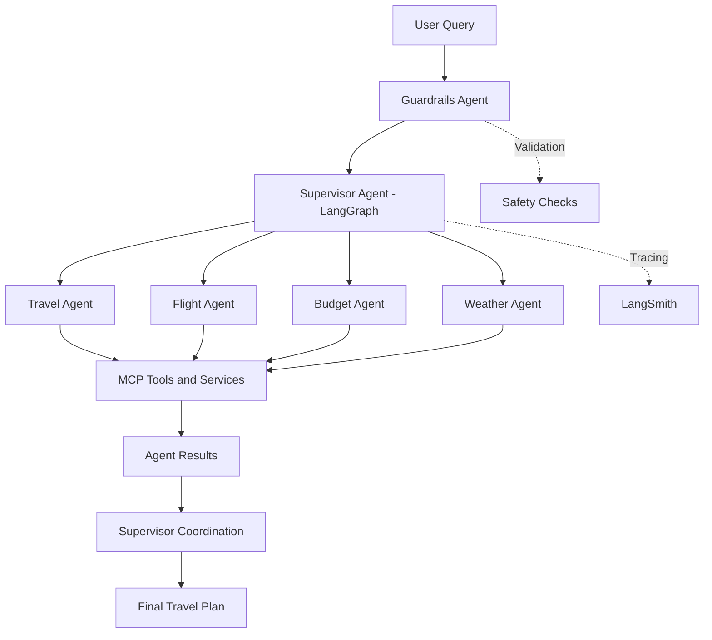

# ✈️ TripPilot AI — Multi-Agent Travel Planning Platform

**TripPilot AI** is an AI-powered travel planning platform built with **LangGraph, LangChain, MCP, and LangSmith**. It uses a supervisor-based multi-agent architecture to understand travel requests, delegate tasks to specialized agents, and generate personalized travel plans.

The platform integrates dedicated agents for travel planning, flights, budget analysis, and weather information, with guardrails for safer request handling and LangSmith for workflow observability.

## 🚀 Key Features

- **Multi-Agent Architecture:** Specialized agents collaborate to handle different aspects of travel planning.
- **Supervisor Agent:** Intelligently routes user requests to the appropriate agents using LangGraph.
- **Guardrails:** Validates user requests and helps enforce application-specific safety rules.
- **MCP Integration:** Connects agents to external tools and services through the Model Context Protocol.
- **Flight Assistance:** Supports flight-related queries through the configured flight tools.
- **Travel Planning:** Helps generate travel recommendations and itinerary information.
- **Budget Planning:** Supports budget estimation and travel cost analysis.
- **Weather Assistance:** Retrieves weather information through configured weather tools.
- **LangSmith Observability:** Enables tracing, debugging, and inspection of agent execution.
- **Docker Support:** Makes the application easier to package and run consistently across environments.

## 🏗️ Architecture



### How It Works

1. The user submits a travel-related request in natural language.
2. The guardrails component validates the request according to the application's configured rules.
3. The Supervisor Agent analyzes the request and determines which specialized agents are needed.
4. The selected agents perform their assigned tasks and interact with available MCP tools.
5. Agent outputs are coordinated into a consolidated response.
6. LangSmith traces help developers inspect execution paths, tool calls, and errors.

## 🧠 Technology Stack

| Technology | Purpose |
|---|---|
| Python | Core application logic |
| LangGraph | Stateful agent workflows and orchestration |
| LangChain | LLM and tool integration |
| MCP | Standardized tool connectivity |
| LangSmith | Tracing, observability, and debugging |
| FastAPI | Backend API |
| Docker | Containerization |
| LLM Provider | Natural-language understanding and response generation |

## 🤖 Specialized Agents

### 1. Supervisor Agent
- Interprets the user's travel requirements.
- Selects the appropriate agents.
- Coordinates execution and combines results.

### 2. Travel Agent
- Handles general travel planning.
- Supports itinerary and destination-related queries.

### 3. Flight Agent
- Handles flight-related requests through configured tools.
- Uses available tool results to support flight planning.

### 4. Budget Agent
- Assists with estimated travel costs.
- Helps organize travel options around budget requirements.

### 5. Weather Agent
- Handles destination weather queries using configured weather tools.
- Provides relevant weather information for travel planning.

### 6. Guardrails
- Checks requests against defined application policies.
- Helps prevent invalid or disallowed requests from proceeding through the workflow.

## 🔌 MCP Integration

TripPilot AI uses the **Model Context Protocol (MCP)** to connect agents with tools through a standardized interface.

MCP can help separate agent reasoning from tool implementation, making the system easier to extend and maintain.

The project supports the configured MCP integrations for travel, flights, budget, and weather.

## 📊 LangSmith Observability

LangSmith is used to inspect and debug the agentic workflow.

Depending on the configured tracing and instrumentation, it can help with:

- Viewing execution traces.
- Inspecting agent transitions.
- Debugging tool invocation failures.
- Analyzing LLM calls and latency.
- Identifying workflow bottlenecks.

## 🛠️ Installation and Setup

### Prerequisites

- Python 3.10 or a compatible version supported by your dependencies.
- Git.
- An LLM provider API key.
- Docker, if running the containerized application.
- Credentials for any external APIs your configured tools require.

### 1. Clone the Repository

```bash
git clone https://github.com/YOUR_USERNAME/TripPilot-AI.git
cd TripPilot-AI
```

Replace `YOUR_USERNAME` and the repository name with your actual GitHub details.

### 2. Create a Virtual Environment

**Windows**

```bash
python -m venv .venv
.venv\Scripts\activate
```

**Linux / macOS**

```bash
python3 -m venv .venv
source .venv/bin/activate
```

### 3. Install Dependencies

If your repository includes a `requirements.txt` file:

```bash
pip install -r requirements.txt
```

### 4. Configure Environment Variables

Create a `.env` file in the project root and add the variables required by your implementation.

Example:

```env
GROQ_API_KEY=your_llm_api_key

LANGSMITH_TRACING=true
LANGSMITH_API_KEY=your_langsmith_api_key
LANGSMITH_PROJECT=TripPilot-AI

FLIGHT_API_KEY=your_flight_api_key
WEATHER_API_KEY=your_weather_api_key
```

Add only the variables your code actually uses. Replace the example names with your implementation's exact environment variable names and configure any additional credentials required by your MCP servers.

**Security:** Never commit `.env` files, API keys, access tokens, or other secrets to GitHub.

### 5. Run the Application

For a FastAPI application, use the entry point defined in your project. For example, if your application object is named `app` in `main.py`:

```bash
uvicorn main:app --reload
```

Open the API documentation at:

```text
http://127.0.0.1:8000/docs
```

Adjust the module name and port to match your implementation.

## 🐳 Run with Docker

Build the image:

```bash
docker build -t trippilot-ai .
```

Run the container:

```bash
docker run --env-file .env -p 8000:8000 trippilot-ai
```

Make sure your Dockerfile, application entry point, and exposed port match your project configuration. If your MCP servers run in separate containers, configure their network addresses appropriately.

## 📁 Project Structure

An example structure for the platform is shown below. Adapt it to match your actual repository.

```text
TripPilot-AI/
├── agents/
│   ├── supervisor.py
│   ├── travel_agent.py
│   ├── flight_agent.py
│   ├── budget_agent.py
│   └── weather_agent.py
├── guardrails/
│   └── ...
├── mcp_servers/
│   └── ...
├── graph/
│   └── ...
├── main.py
├── requirements.txt
├── Dockerfile
├── .env.example
├── .gitignore
└── README.md
```

## 🔐 Security and Reliability

- Keep API credentials in environment variables.
- Validate inputs before invoking tools.
- Configure timeouts and error handling for external API calls.
- Restrict tool permissions to the operations each agent needs.
- Handle unavailable MCP servers and failed LLM requests gracefully.
- Test routing, tool execution, and guardrail behavior.
- Avoid presenting estimated prices or unverified flight information as confirmed results.

## 🔮 Future Enhancements

Potential improvements include:

- Persistent conversations and user travel preferences.
- Human approval for important actions such as bookings.
- Parallel execution of independent agents.
- Retry policies and fallback models.
- Automated tests for routing and guardrails.
- Deployment monitoring and performance evaluation.
- Integration with verified booking services.

## 🎯 Project Goal

TripPilot AI explores how agentic AI can simplify travel planning by combining specialized agents, tool interoperability, workflow orchestration, and observability in a single platform.

