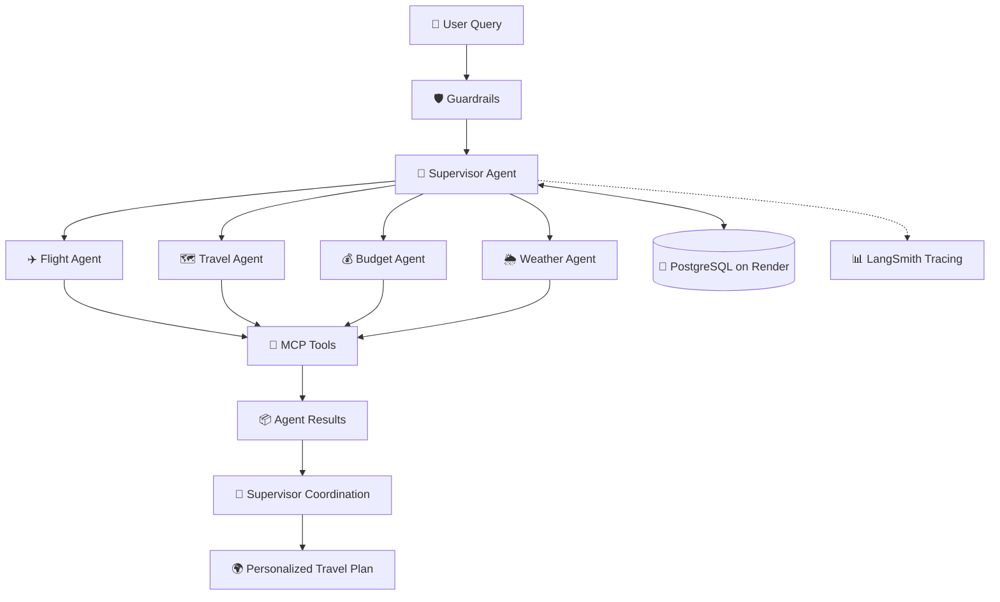

# ✈️ TripPilot AI

### 🌍 Your Intelligent AI Travel Companion

<p align="center">
  
  
  
  
  
  
  
  
</p>
<p align="center">
  <b>🌐 Live Application:</b>
  <a href="https://trippilot-ai-multi-agent-ai-system-with.onrender.com/">Try TripPilot AI</a>
</p>

**TripPilot AI** is a multi-agent travel planning platform that transforms natural-language travel requests into personalized travel plans using intelligent agent orchestration, external tools, and persistent memory.

Powered by **LangGraph, MCP, and LangSmith**, TripPilot AI uses a Supervisor Agent to coordinate specialized agents for travel, flights, budget, and weather, while PostgreSQL on Render Cloud supports persistent application state.

> 💡 Plan smarter. Travel better. Let AI coordinate your journey.

---

## ✨ Features

| Feature | Description |
|---|---|
| 🧠 Multi-Agent AI | Specialized agents collaborate to handle travel-related tasks. |
| 🎯 Supervisor Agent | Intelligently routes requests and coordinates agent execution. |
| 🛡️ Guardrails | Validates inputs and applies configured safety policies. |
| 🔌 MCP Integration | Connects agents to external tools using the Model Context Protocol. |
| ✈️ Flight Assistance | Supports flight-related queries through configured tools. |
| 🗺️ Travel Planning | Helps generate destination recommendations and itineraries. |
| 💰 Budget Planning | Assists with travel cost estimation and budget-aware planning. |
| 🌦️ Weather Intelligence | Retrieves weather information through configured services. |
| 💾 Persistent Memory | PostgreSQL on Render Cloud stores configured persistent state. |
| 📊 Observability | LangSmith helps trace and debug agent workflows. |
| 🐳 Containerization | Docker support for consistent deployment environments. |

---

## 🏗️ System Architecture



### 🔄 How It Works

1. 👤 The user submits a travel request in natural language.
2. 🛡️ Guardrails validate the request against configured rules.
3. 🧠 The Supervisor Agent determines which specialized agents are needed.
4. 🔌 Agents interact with configured MCP tools and external services.
5. 💾 PostgreSQL persists application state through the configured memory mechanism.
6. 🎯 The supervisor coordinates agent outputs into a final response.
7. 📊 LangSmith traces help developers inspect and debug execution.

---

## 🤖 Meet the Agents

<details>
<summary>🧠 Supervisor Agent</summary>

The central orchestrator of TripPilot AI.

- Analyzes user intent.
- Selects the appropriate agents.
- Coordinates the workflow using LangGraph.
- Combines agent outputs into a unified response.

</details>

<details>
<summary>✈️ Flight Agent</summary>

Handles flight-related requests using the configured flight tools and available service data.

</details>

<details>
<summary>🗺️ Travel Agent</summary>

Assists with destination discovery, travel recommendations, and itinerary planning.

</details>

<details>
<summary>💰 Budget Agent</summary>

Helps estimate trip expenses and organize travel options around budget requirements.

</details>

<details>
<summary>🌦️ Weather Agent</summary>

Retrieves destination weather information through configured weather tools.

</details>

<details>
<summary>🛡️ Guardrails</summary>

Applies request validation and application-specific safety rules before or during agent execution, according to the configured workflow.

</details>

---

## 🔌 MCP — Model Context Protocol

TripPilot AI uses MCP to connect agents with tools through a standardized interface.

**Why MCP?**

- 🔗 Standardized communication between agents and tools.
- 🧩 Modular integrations that are easier to extend.
- 🔧 Separation of agent logic from tool implementations.
- 🌐 Support for configured local or remote MCP servers.

---

## 💾 Long-Term Memory — PostgreSQL + Render

TripPilot AI uses **PostgreSQL hosted on Render Cloud** for persistent storage.

### Key Capabilities

- 💾 Persistent storage beyond an individual application process.
- 🧵 Checkpointed workflow state when using a PostgreSQL-backed LangGraph checkpointer.
- 🔄 Conversation resumption using consistent thread identifiers.
- ☁️ Managed cloud database infrastructure.
- 🧠 A foundation for persistent conversational memory.

> **Note:** Persistent checkpoints and long-term semantic memory are different. Recalling user preferences across conversations requires appropriate memory storage and retrieval logic.

---

## 📊 LangSmith Observability

LangSmith helps make agentic workflows easier to inspect and debug.

- 🔍 Execution traces and workflow visibility.
- 🔄 Agent transitions and tool invocation inspection.
- 🐛 Debugging failed executions.
- ⏱️ Latency analysis and performance investigation.
- 🧪 Evaluation and quality improvement workflows, where configured.

---

## 🛠️ Tech Stack

<p align="center">
  
</p>

| Category | Technologies |
|---|---|
| Language | Python |
| Agent Orchestration | LangGraph |
| LLM Framework | LangChain |
| Tool Connectivity | MCP |
| Observability | LangSmith |
| Database | PostgreSQL |
| Cloud Infrastructure | Render |
| Backend | FastAPI |
| Containerization | Docker |
| Model Provider | Configured LLM provider |

---

## ⚙️ Installation & Setup

### 1️⃣ Clone the Repository

```bash
git clone https://github.com/YOUR_USERNAME/TripPilot-AI.git
cd TripPilot-AI
```

### 2️⃣ Create a Virtual Environment

**Windows**

```bash
python -m venv .venv
.venv\Scripts\activate
```

**Linux / macOS**

```bash
python3 -m venv .venv
source .venv/bin/activate
```

### 3️⃣ Install Dependencies

```bash
pip install -r requirements.txt
```

### 4️⃣ Configure Environment Variables

Create a `.env` file with the variables required by your implementation.

```env
GROQ_API_KEY=your_llm_api_key

LANGSMITH_TRACING=true
LANGSMITH_API_KEY=your_langsmith_api_key
LANGSMITH_PROJECT=TripPilot-AI

DATABASE_URL=your_postgresql_connection_url

FLIGHT_API_KEY=your_flight_api_key
WEATHER_API_KEY=your_weather_api_key
```

Replace these example names with the actual variables your code uses.

🔐 **Never commit API keys, database credentials, or your `.env` file to GitHub.**

### 5️⃣ Run the Application

For a FastAPI entry point named `main.py` containing `app`:

```bash
uvicorn main:app --reload
```

API documentation, if enabled:

```text
http://127.0.0.1:8000/docs
```

Use the correct module name and port for your project.

---

## 🐳 Docker

Build your image:

```bash
docker build -t trippilot-ai .
```

Run the container:

```bash
docker run --env-file .env -p 8000:8000 trippilot-ai
```

Make sure your Dockerfile and application configuration match these commands.

---

## ☁️ Cloud Deployment

TripPilot AI uses Render Cloud for PostgreSQL hosting and can run its backend on a compatible Render service.

- 🐘 **PostgreSQL:** Persistent database storage.
- 🔐 **Environment Variables:** Secure configuration for API keys and database credentials.
- 🚀 **Deployment:** Deploy the backend from your connected GitHub repository.
- 📋 **Logs:** Inspect application startup, runtime errors, and database connectivity.

---

## 🔐 Reliability & Security

- Validate inputs before tool execution.
- Handle timeouts, failed API calls, and unavailable MCP servers.
- Keep credentials in environment variables.
- Restrict tool and database permissions.
- Test supervisor routing and guardrail behavior.
- Avoid presenting estimated costs or unverified flight details as confirmed information.

---

## 🚀 Future Improvements

- 🧠 Semantic memory and personalized travel preferences.
- 🧪 Automated agent evaluation and regression tests.
- 🔁 Retry policies and model fallbacks.
- 👤 Human approval for booking-related actions.
- 📈 Enhanced performance monitoring.
- 🌐 Additional travel service integrations.

---

## 👨‍💻 Author

**Prakhar Patel**

- 🐙 GitHub: [Your GitHub Profile](https://github.com/YOUR_USERNAME)
- 💼 LinkedIn: [Your LinkedIn Profile](https://www.linkedin.com/)

---

## 📄 License

Add a `LICENSE` file to specify the terms under which others may use, modify, and distribute this project.

---

<p align="center">
  <b>✈️ TripPilot AI — Intelligent Agents. Smarter Journeys. 🌍</b>
</p>
